# Enterprise RAG Retrievers — 20-Part Tutorial

**Stack:** LangChain v1, LangGraph, Astra DB, BM25, Reciprocal Rank Fusion (RRF), Vertex AI embeddings/reranking, Google Cloud Storage, PostgreSQL, Redis, and LangSmith/OpenTelemetry.

> **Implementation note:** The snippets are practical patterns, not a single tested lockfile. LangChain integration imports and constructor signatures can change between releases. Pin compatible package versions and verify the APIs in your environment. Keep credentials in Secret Manager, never in source code.

## Table of contents

1. Retriever fundamentals
2. Enterprise hybrid retrieval architecture
3. Ingestion, chunking, and metadata
4. Vector similarity retrieval
5. Maximum Marginal Relevance (MMR)
6. BM25 keyword retrieval
7. Ensemble retrieval and RRF
8. Contextual compression
9. Cross-encoder reranking
10. Multi-query retrieval
11. Query decomposition
12. Self-query and metadata filtering
13. Parent-document retrieval
14. Multi-vector retrieval
15. Time-weighted retrieval
16. Merger, router, and custom retrievers
17. LangGraph retrieval orchestration
18. Security, tenancy, and failure handling
19. Evaluation, observability, and optimization
20. Production deployment blueprint

---

# 1. Retriever fundamentals

A **retriever** accepts a query and returns documents that may contain useful evidence. It is an abstraction over a search mechanism; it does not have to use a vector database.

```python
from langchain_core.documents import Document
from langchain_core.retrievers import BaseRetriever

# Conceptual contract:
# retriever.invoke("question") -> list[Document]
```

Distinguish these components:

| Component | Responsibility |
|---|---|
| Vector store | Stores embeddings and exposes similarity search |
| Retriever | Converts a query into relevant `Document` objects |
| Chain | Composes deterministic processing steps |
| Agent | Dynamically chooses actions or tools |
| LangGraph | Orchestrates stateful workflows, routing, retries, and parallel work |

A retriever may call vector search, BM25, SQL, an API, or multiple backends. It may also normalize a query, apply filters, fuse rankings, rerank candidates, or compress documents.

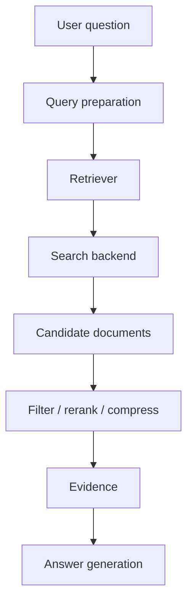

Evaluate retrievers on **Recall**, **Precision**, ranking quality, coverage, latency, cost, and authorization correctness.

# 2. Enterprise hybrid retrieval architecture

Enterprise search generally combines semantic, lexical, and structured retrieval.

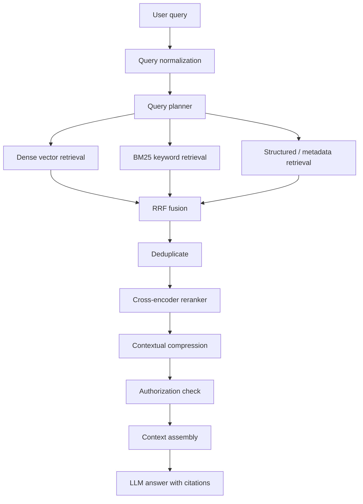

| Layer | Purpose |
|---|---|
| Query normalization | Fix safe formatting and spelling variations without changing intent |
| Query planning | Detect intent, entities, constraints, and decomposition needs |
| Dense retrieval | Semantic matching and paraphrase tolerance |
| BM25 | Exact terms, IDs, error codes, and rare keywords |
| Structured retrieval | Filter by tenant, ACL, product, date, region, and type |
| Fusion | Combine ranked result lists |
| Reranking | Improve relevance ordering |
| Compression | Keep evidence-bearing passages and reduce noise |
| Context assembly | Fit evidence to a token budget with provenance |
| Generation | Answer from evidence and cite sources |

Hybrid search is especially valuable for questions containing exact identifiers alongside natural language, such as `ORA-12514`, a product version, or a Kubernetes resource name.

# 3. Ingestion, chunking, and metadata

Retrieval quality starts at ingestion. Poor extraction, chunking, or metadata cannot reliably be repaired by a sophisticated retriever.

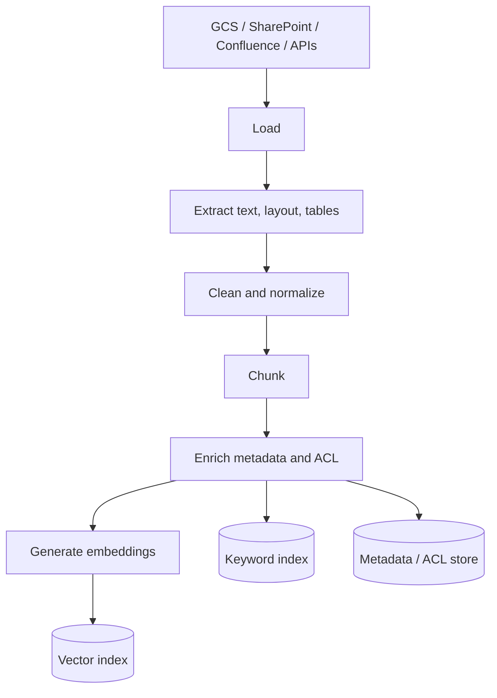

Example chunking:

```python
from langchain_text_splitters import RecursiveCharacterTextSplitter

splitter = RecursiveCharacterTextSplitter(
    chunk_size=900,
    chunk_overlap=120,
    separators=["\n\n", "\n", ". ", " ", ""],
)
chunks = splitter.split_documents(documents)
```

Example metadata:

```python
metadata = {
    "tenant_id": "tenant-123",
    "document_id": "policy-456",
    "chunk_id": "policy-456:v7:chunk-12",
    "title": "Annual Leave Policy",
    "section": "Eligibility",
    "document_type": "policy",
    "region": "AU-VIC",
    "classification": "internal",
    "allowed_groups": ["employees", "hr"],
    "version": 7,
    "effective_date": "2026-01-01",
}
```

Use stable IDs. For example:

```text
document_id = source_system + ":" + source_native_id
chunk_id = document_id + ":" + content_version + ":" + chunk_index
```

This supports incremental updates, deletes, citations, and versioning. Keep metadata typed and validate it at ingestion.

# 4. Vector similarity retrieval

A vector retriever embeds the query and searches for nearby document vectors.

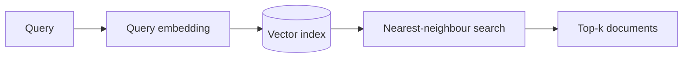

Illustrative Astra DB + Vertex AI pattern:

```python
from langchain_astradb import AstraDBVectorStore
from langchain_google_vertexai import VertexAIEmbeddings

embeddings = VertexAIEmbeddings(
    model_name="text-embedding-004",
    project="YOUR_GCP_PROJECT",
    location="us-central1",
)

vector_store = AstraDBVectorStore(
    collection_name="enterprise_rag",
    embedding=embeddings,
    api_endpoint="YOUR_ASTRA_DB_API_ENDPOINT",
    token="LOAD_FROM_SECRET_MANAGER",
)

vector_retriever = vector_store.as_retriever(
    search_type="similarity",
    search_kwargs={"k": 20},
)

docs = vector_retriever.invoke(
    "How does annual leave accrual work?"
)
```

Similarity metrics include cosine similarity, dot product, and Euclidean distance. Use the metric expected by the embedding model and index configuration.

Typical tuning starting points might be 20–50 candidates from vector search, then fusion, reranking, and a smaller final evidence set. These are not universal defaults: tune with Recall@k, latency, and cost measurements.

# 5. Maximum Marginal Relevance (MMR)

Similarity search can return many near-duplicate chunks. **MMR** balances query relevance with diversity:

\[
MMR(D_i)=\lambda Sim(D_i,Q)-(1-\lambda)\max_{D_j\in Selected}Sim(D_i,D_j)
\]

- `lambda_mult` closer to 1 favours query similarity.
- Lower values favour diversity.
- `fetch_k` is the candidate pool; `k` is the final result count.

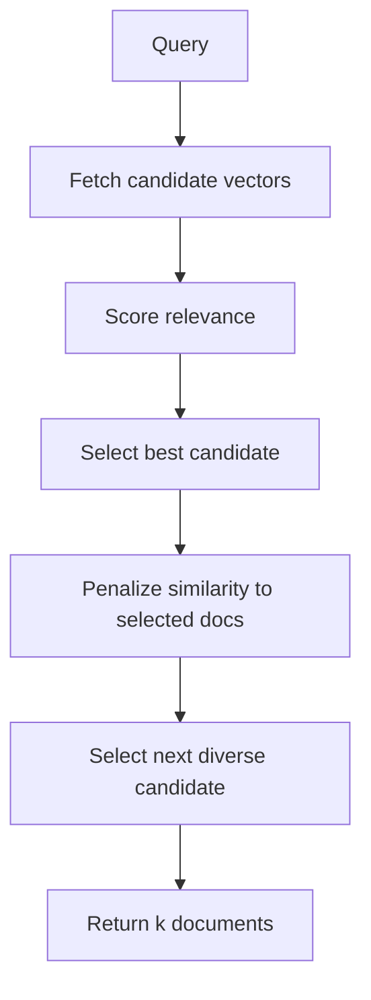

```python
mmr_retriever = vector_store.as_retriever(
    search_type="mmr",
    search_kwargs={
        "k": 8,
        "fetch_k": 40,
        "lambda_mult": 0.65,
    },
)
docs = mmr_retriever.invoke(
    "Compare security responsibilities of application and platform teams"
)
```

Use MMR for broad questions, comparisons, or repetitive results. For an exact error-code lookup, ordinary similarity or lexical search may be better.

# 6. BM25 keyword retrieval

BM25 is a sparse lexical ranking algorithm. It uses term frequency, inverse document frequency, and document-length normalization.

It is strong for error codes, stack traces, acronyms, product names, versions, SKUs, and exact policy terminology.

```python
from langchain_community.retrievers import BM25Retriever

bm25_retriever = BM25Retriever.from_documents(chunks, k=20)
docs = bm25_retriever.invoke(
    "ORA-12514 listener does not currently know service requested"
)
```

An in-memory BM25 retriever is useful for demonstrations and small corpora. For a distributed production service, use a durable search backend or build and refresh the lexical index as part of ingestion.

BM25 tuning includes:

- `k1`: term-frequency saturation.
- `b`: document-length normalization.
- Analyzer/tokenizer: how text is split.
- Stop-word policy: avoid removing meaningful domain terms.
- Stemming: can help prose but can damage identifiers.

For code and IDs, preserve punctuation and token boundaries carefully.

# 7. Ensemble retrieval and Reciprocal Rank Fusion (RRF)

Ensemble retrieval combines several retrievers. A common enterprise baseline is dense vector + BM25.

Raw scores from different retrievers are not necessarily comparable. RRF combines **ranks**:

\[
RRF(d)=\sum_{r\in R}\frac{w_r}{k_0+rank_r(d)}
\]

`w_r` is a retriever weight and `k0` is a smoothing constant (often around 60).

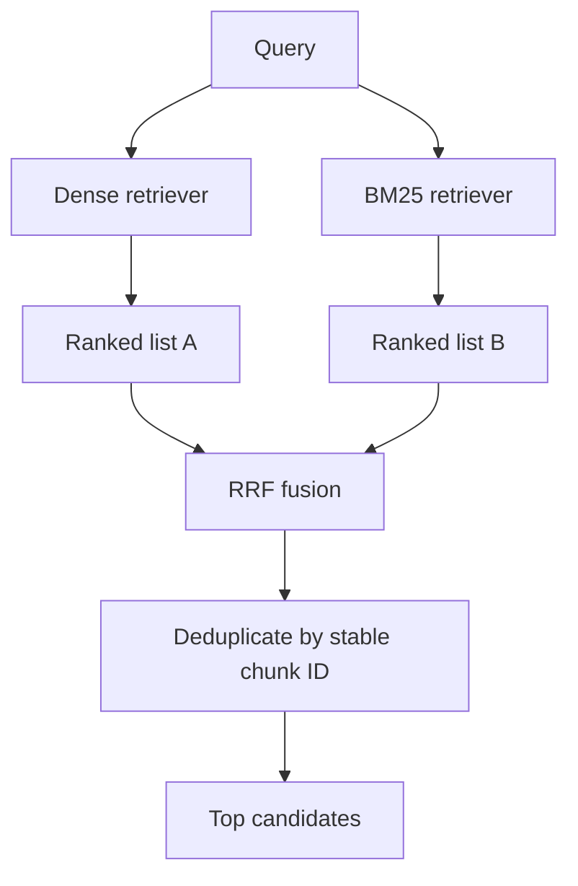

LangChain ensemble example:

```python
from langchain_classic.retrievers import EnsembleRetriever
from langchain_community.retrievers import BM25Retriever

bm25_retriever = BM25Retriever.from_documents(chunks, k=30)
vector_retriever = vector_store.as_retriever(
    search_kwargs={"k": 30}
)

hybrid_retriever = EnsembleRetriever(
    retrievers=[bm25_retriever, vector_retriever],
    weights=[0.4, 0.6],
)
docs = hybrid_retriever.invoke("Troubleshoot error ORA-12514")
```

Standalone RRF implementation:

```python
from collections import defaultdict

def reciprocal_rank_fusion(
    ranked_lists,
    weights=None,
    k0=60,
    id_fn=lambda doc: doc.metadata["chunk_id"],
):
    if weights is None:
        weights = [1.0] * len(ranked_lists)

    scores = defaultdict(float)
    documents = {}

    for weight, ranked_docs in zip(weights, ranked_lists):
        for rank, doc in enumerate(ranked_docs, start=1):
            doc_id = id_fn(doc)
            scores[doc_id] += weight / (k0 + rank)
            documents[doc_id] = doc

    ordered_ids = sorted(scores, key=scores.get, reverse=True)
    return [(documents[i], scores[i]) for i in ordered_ids]
```

Use stable chunk IDs; text equality is not a safe identity because identical text may exist in different tenants or source documents. Start with equal weights, then tune against a labelled evaluation set.

# 8. Contextual compression

Contextual compression reduces retrieved content passed to the LLM. It can filter irrelevant documents or extract relevant passages from long documents.

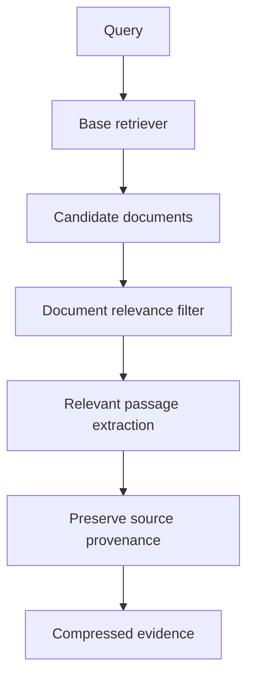

Two main approaches:

1. **Document filtering:** Keep or discard whole documents.
2. **Document extraction:** Keep only query-relevant portions of a document.

Illustrative LangChain pattern:

```python
from langchain_classic.retrievers import ContextualCompressionRetriever
from langchain_classic.retrievers.document_compressors import LLMChainExtractor
from langchain_google_vertexai import ChatVertexAI

llm = ChatVertexAI(
    model="gemini-2.5-flash",
    location="us-central1",
    temperature=0,
)

compressor = LLMChainExtractor.from_llm(llm)

compression_retriever = ContextualCompressionRetriever(
    base_retriever=hybrid_retriever,
    base_compressor=compressor,
)

compressed_docs = compression_retriever.invoke(
    "What are the employee eligibility rules for annual leave?"
)
```

Imports may differ by LangChain release; pin and verify the package versions you deploy.

| Compressor | Behaviour | Typical use |
|---|---|---|
| LLM filter | Keep/discard whole docs | Short documents |
| LLM extractor | Extract relevant spans | Long documents |
| Embeddings filter | Semantic threshold filter | Lower-cost filtering |
| Cross-encoder filter | Query-document relevance score | More precise filtering |
| Rule-based filter | Deterministic pattern matching | IDs, dates, known fields |

Compression risks include losing qualifying conditions, removing headings, paraphrasing evidence, and breaking citations. Preserve original document IDs, versions, and source locations. Treat extracted text as a derived view, not as a replacement for the source.

A practical staged pattern is: retrieve broadly → fuse → rerank → compress a bounded set → assemble context within a token budget. Do not spend LLM calls compressing a large set of poor candidates.

# 9. Cross-encoder reranking

A bi-encoder embeds query and document separately. A cross-encoder scores the query and document together, enabling deeper token-level interaction.

| Property | Bi-encoder | Cross-encoder |
|---|---|---|
| Encoding | Query/document separately | Query + document together |
| Speed | Fast | Slower per candidate |
| Document vectors precomputed | Yes | Usually no |
| Role | Candidate retrieval | Final ranking |

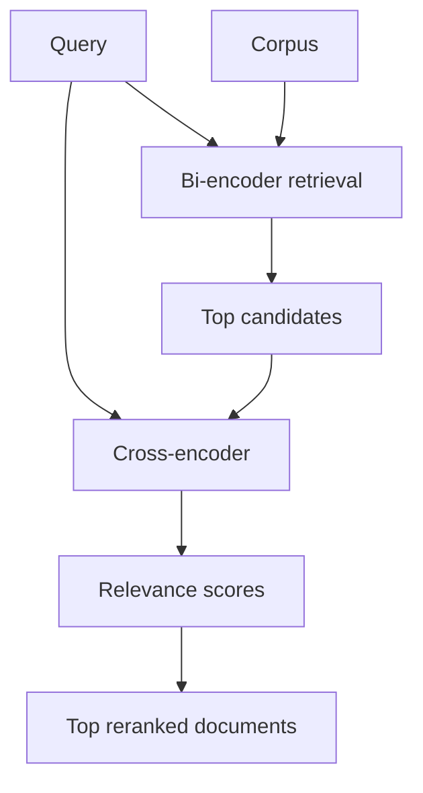

Example using a Hugging Face cross-encoder wrapper:

```python
from langchain_community.document_compressors import CrossEncoderReranker
from langchain_community.cross_encoders import HuggingFaceCrossEncoder

cross_encoder = HuggingFaceCrossEncoder(
    model_name="BAAI/bge-reranker-base"
)
reranker = CrossEncoderReranker(model=cross_encoder, top_n=8)

reranked_docs = reranker.compress_documents(
    documents=hybrid_docs,
    query="How do I troubleshoot error ORA-12514?",
)
```

A managed Vertex AI ranking service can be wrapped behind an adapter with the same conceptual contract: query + candidate documents → ranked documents. Keep provider-specific code outside the graph.

Rerank a bounded candidate set, for example the fused top 20–50, rather than the full corpus.

# 10. Multi-query retrieval

Multi-query retrieval generates alternate formulations of one question to improve recall when user wording differs from source wording.

Example:

- Original: “How do I rotate the cluster certificate?”
- Variant: “Steps to renew the Kubernetes cluster CA certificate”
- Variant: “How to replace an expired cluster certificate”
- Variant: “Certificate rotation procedure for managed Kubernetes”

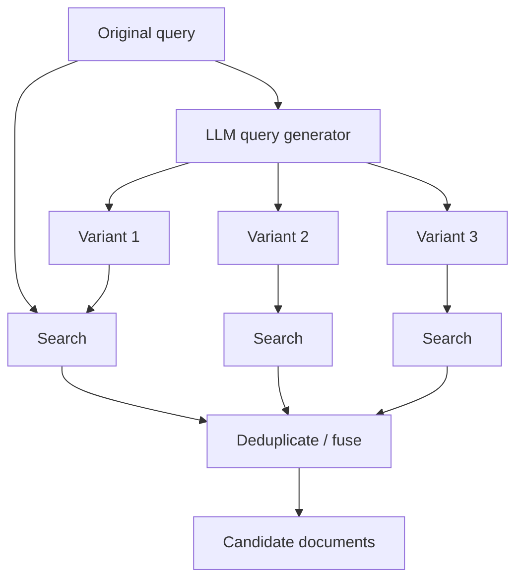

```python
from langchain_classic.retrievers.multi_query import MultiQueryRetriever

multi_query_retriever = MultiQueryRetriever.from_llm(
    retriever=vector_retriever,
    llm=llm,
)
docs = multi_query_retriever.invoke(
    "How do I rotate the cluster certificate?"
)
```

Production controls:

- Limit the number of variants.
- Always retain the original query.
- Deduplicate by stable document ID.
- Preserve product, version, date, and region constraints.
- Log variants for evaluation.
- Skip this step for simple exact lookups when it adds no value.

Multi-query can multiply search traffic and model calls. Use it selectively.

# 11. Query decomposition

Multi-query creates alternative expressions of one question. **Decomposition** splits a complex question into independently answerable subquestions.

Example: “Compare availability, security, and cost of Cloud Run and GKE for a multi-tenant agent service.”

Subquestions:
1. What are the availability characteristics?
2. How do security and tenant isolation compare?
3. What are the main cost drivers?
4. What operational responsibilities differ?

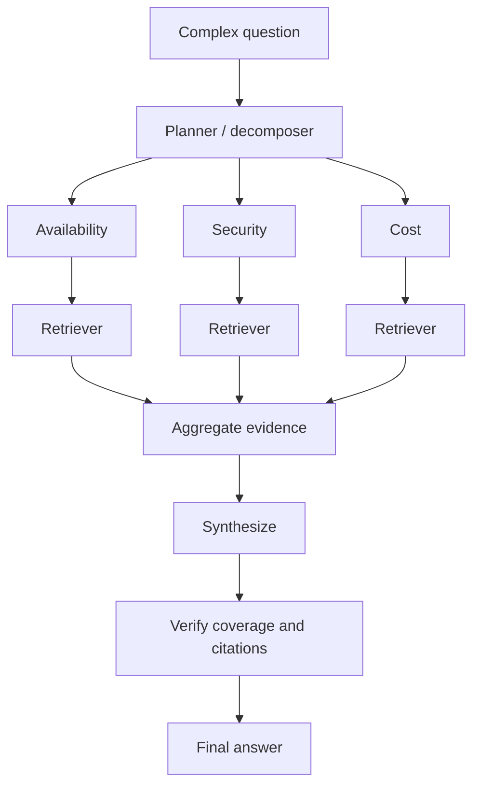

Structured output schema:

```python
from pydantic import BaseModel, Field

class QueryPlan(BaseModel):
    subqueries: list[str] = Field(
        description="At most four independent search questions"
    )

planner_prompt = """
Break the user's question into at most four independent search questions.
Preserve named products, versions, dates, regions, and constraints.
Do not answer the question. Return a structured query plan.
"""

# Example:
# planner = llm.with_structured_output(QueryPlan)
# plan = planner.invoke([
#     ("system", planner_prompt),
#     ("human", user_question),
# ])
```

Use decomposition for compound comparisons, multiple entities, or questions needing evidence from several document families. Do not decompose every query: a simple factual lookup should remain one retrieval.

# 12. Self-query retrieval and metadata filters

Self-query retrieval interprets natural-language constraints and converts them into a semantic query plus structured metadata filters.

Example request: “Find the latest Australian HR policy documents updated after January 2025.”

Possible interpretation:

```json
{
  "semantic_query": "HR policy documents",
  "filters": {
    "region": "AU",
    "document_type": "policy",
    "updated_at": {"$gt": "2025-01-01"}
  }
}
```

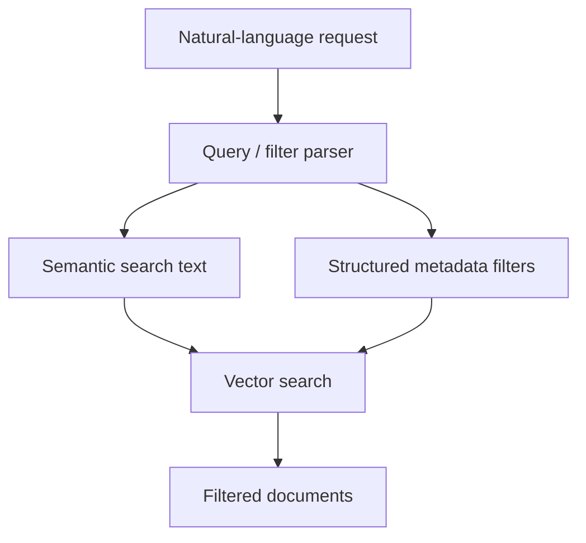

Illustrative setup:

```python
from langchain_classic.retrievers.self_query.base import SelfQueryRetriever

# Define metadata_field_info with allowed field names, types,
# and descriptions, then configure a compatible vector store.
#
# self_query_retriever = SelfQueryRetriever.from_llm(
#     llm=llm,
#     vectorstore=vector_store,
#     document_contents="Enterprise policy and technical documentation",
#     metadata_field_info=metadata_field_info,
# )
```

Self-query is a query-interpretation feature, **not an authorization system**. Tenant and ACL filters must come from trusted authenticated identity and server-side policy. Never trust tenant IDs or access groups generated by an LLM or supplied only in user text.

# 13. Parent-document retrieval

Small child chunks match queries precisely but may lack context. Parent-document retrieval indexes small child chunks and returns their larger parent section.

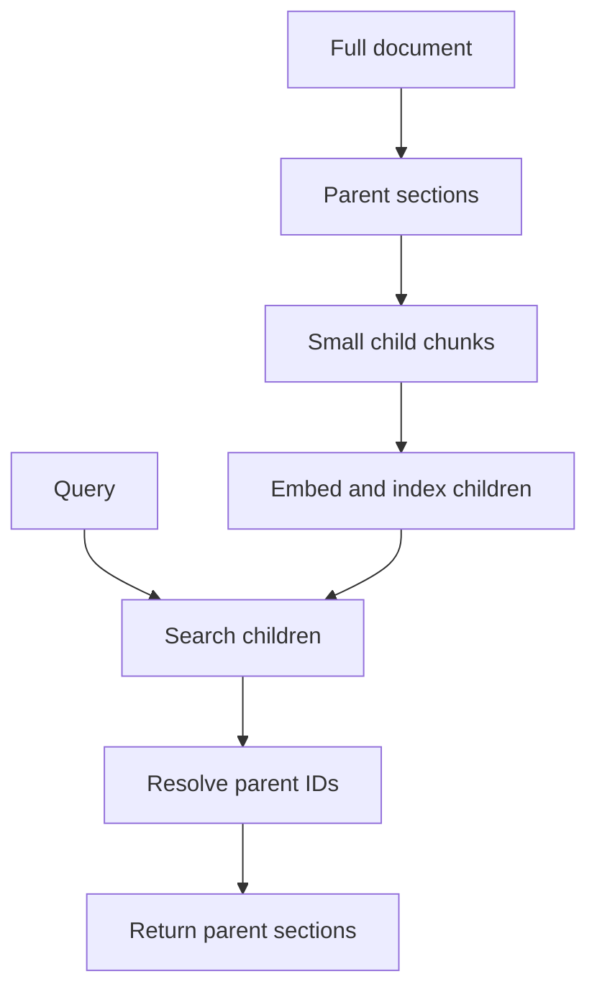

For example, a child chunk saying “The limit is 30 days” may not explain whether it refers to retention, appeals, or leave carry-over. The parent section restores that context.

```python
from langchain_classic.retrievers import ParentDocumentRetriever
from langchain.storage import InMemoryStore
from langchain_text_splitters import RecursiveCharacterTextSplitter

parent_splitter = RecursiveCharacterTextSplitter(
    chunk_size=2000, chunk_overlap=200
)
child_splitter = RecursiveCharacterTextSplitter(
    chunk_size=400, chunk_overlap=60
)

docstore = InMemoryStore()

parent_retriever = ParentDocumentRetriever(
    vectorstore=vector_store,
    docstore=docstore,
    child_splitter=child_splitter,
    parent_splitter=parent_splitter,
)

# parent_retriever.add_documents(source_documents)
# docs = parent_retriever.invoke("What is the retention period?")
```

For production, use durable parent storage and tenant-aware parent resolution. A child must never resolve to a parent the caller cannot access.

# 14. Multi-vector retrieval

Multi-vector retrieval stores several searchable representations for one canonical document: text chunks, summaries, hypothetical questions, table descriptions, image captions, or section summaries.

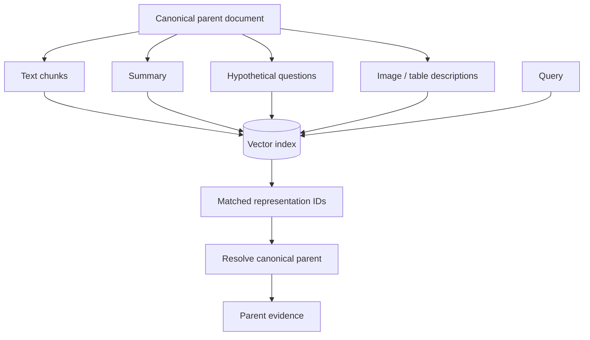

Design rules:

- Store representation type and canonical parent ID.
- Deduplicate by parent ID where appropriate.
- Keep the original source for citations.
- Version summaries/captions when source content changes.
- Do not treat generated summaries as more authoritative than the source.

This is useful for long documents, tables, diagrams, and user queries that differ significantly from the source wording.

# 15. Time-weighted and recency-aware retrieval

Some domains value recent content: incident runbooks, release notes, operational status, and revised policies.

A simple conceptual score is:

\[
Score(d)=\alpha Relevance(d,Q)+\beta Freshness(d)
\]

One freshness function is exponential decay:

\[
Freshness(d)=e^{-\lambda age(d)}
\]

The decay rate should reflect the domain. An incident status may become stale within hours; a policy may remain effective for years.

Recommended approach:

1. Filter expired or superseded documents where possible.
2. Retrieve semantically relevant candidates.
3. Apply deterministic version and effective-date rules.
4. Use freshness as a ranking signal only when appropriate.
5. Show effective dates and versions in citations.

Do not assume the newest file is the currently effective policy.

# 16. Merger, router, and custom retrievers

## 16.1 Merger retriever

A merger combines documents from multiple sources. Merging does not automatically provide a meaningful global ranking; use RRF or another ranking method if order matters.

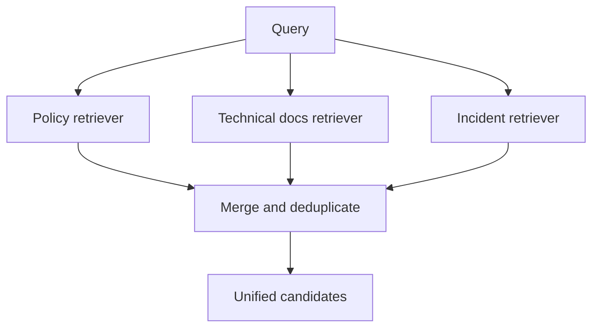

## 16.2 Router retriever

A router selects retrieval systems based on intent.

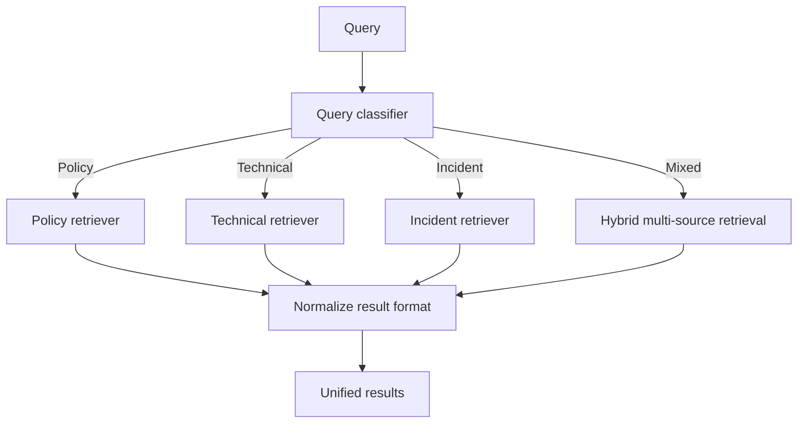

Use routing when corpora have different schemas, access rules, latency, or relevance characteristics.

## 16.3 Custom API retriever

```python
from typing import Any
import httpx
from pydantic import PrivateAttr
from langchain_core.documents import Document
from langchain_core.retrievers import BaseRetriever

class InternalSearchRetriever(BaseRetriever):
    endpoint: str
    timeout_seconds: float = 5.0
    _client: Any = PrivateAttr(default=None)

    def model_post_init(self, __context):
        self._client = httpx.Client(timeout=self.timeout_seconds)

    def _get_relevant_documents(self, query: str, *, run_manager):
        response = self._client.post(
            self.endpoint,
            json={"query": query},
        )
        response.raise_for_status()
        payload = response.json()

        return [
            Document(
                page_content=item["text"],
                metadata=item.get("metadata", {}),
            )
            for item in payload.get("results", [])
        ]
```

Production hardening: authentication, trusted tenant/ACL enforcement, request IDs, response validation, bounded retries, circuit breaking, connection lifecycle management, and structured errors. Do not log bearer tokens or secrets.

## 16.4 Retriever, node, tool, or agent?

| Abstraction | Use when |
|---|---|
| Retriever | Operation is fundamentally query-in, documents-out |
| Graph node | Explicit state transition, validation, retry, or branching is needed |
| Tool | An agent should choose whether to invoke a capability |
| Agent | The model dynamically chooses among actions |
| Subgraph | A reusable workflow has its own state and lifecycle |

Keep retrieval predictable. Do not turn every retriever into a general-purpose agent.

# 17. LangGraph retrieval orchestration

LangGraph is useful when retrieval needs state, parallel branches, routing, retries, human review, or evidence verification.

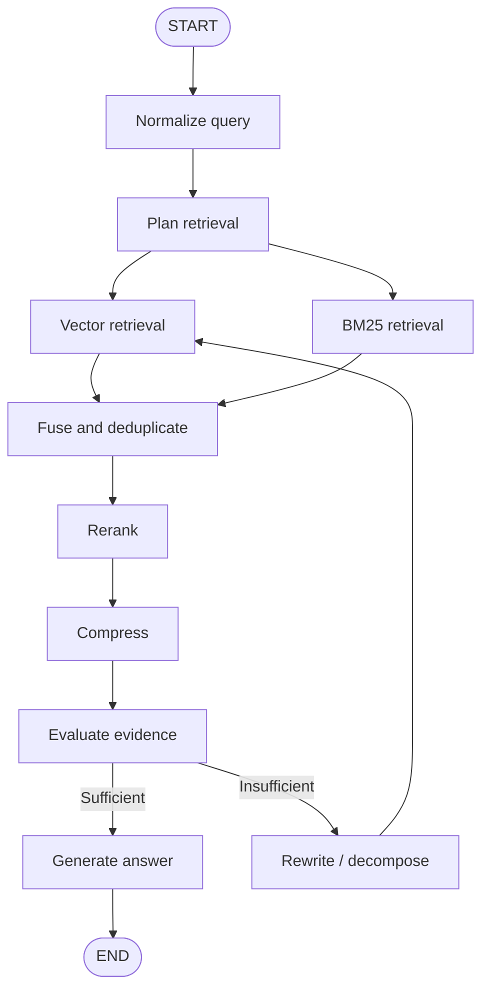

State schema:

```python
from typing import TypedDict
from langchain_core.documents import Document

class RetrievalState(TypedDict, total=False):
    question: str
    normalized_query: str
    subqueries: list[str]
    tenant_id: str
    authorized_groups: list[str]
    vector_docs: list[Document]
    keyword_docs: list[Document]
    fused_docs: list[Document]
    reranked_docs: list[Document]
    compressed_docs: list[Document]
    evidence_sufficient: bool
    answer: str
    retrieval_attempt: int
    errors: list[str]
```

Derive tenant identity and authorized groups from trusted runtime authentication context, not user-controlled state.

Example nodes:

```python
def normalize_query(state: RetrievalState) -> dict:
    return {"normalized_query": state["question"].strip()}

def retrieve_vector(state: RetrievalState) -> dict:
    docs = vector_retriever.invoke(state["normalized_query"])
    return {"vector_docs": docs}

def retrieve_keyword(state: RetrievalState) -> dict:
    docs = bm25_retriever.invoke(state["normalized_query"])
    return {"keyword_docs": docs}

def fuse_results(state: RetrievalState) -> dict:
    fused = reciprocal_rank_fusion(
        [state.get("vector_docs", []), state.get("keyword_docs", [])],
        weights=[0.6, 0.4],
    )
    return {"fused_docs": [doc for doc, _score in fused]}
```

Graph construction:

```python
from langgraph.graph import StateGraph, START, END

builder = StateGraph(RetrievalState)
builder.add_node("normalize", normalize_query)
builder.add_node("vector", retrieve_vector)
builder.add_node("keyword", retrieve_keyword)
builder.add_node("fuse", fuse_results)

builder.add_edge(START, "normalize")
builder.add_edge("normalize", "vector")
builder.add_edge("normalize", "keyword")
builder.add_edge("vector", "fuse")
builder.add_edge("keyword", "fuse")
builder.add_edge("fuse", END)

retrieval_graph = builder.compile()
```

Distinct output keys allow parallel nodes to write independently. If multiple nodes update the same state key in one superstep, define a reducer.

## Fan-out using Send

For variable subquery counts, `Send` can dispatch one task per query:

```python
from typing import Annotated
import operator
from typing_extensions import TypedDict
from langgraph.types import Send

class SearchTask(TypedDict):
    query: str

class FanoutState(TypedDict, total=False):
    question: str
    subqueries: list[str]
    results: Annotated[list[list[Document]], operator.add]

def dispatch_searches(state: FanoutState):
    return [
        Send("search_one", {"query": query})
        for query in state["subqueries"]
    ]

def search_one(state: SearchTask):
    docs = hybrid_retriever.invoke(state["query"])
    return {"results": [docs]}
```

Add the `search_one` node and an aggregation path to the graph. Test empty fan-out, partial failures, and duplicate results. Use a strict maximum number of retrieval attempts to prevent unbounded loops.

# 18. Security, tenancy, and failure handling

Security belongs in the retrieval infrastructure and must be rechecked before context reaches the model.

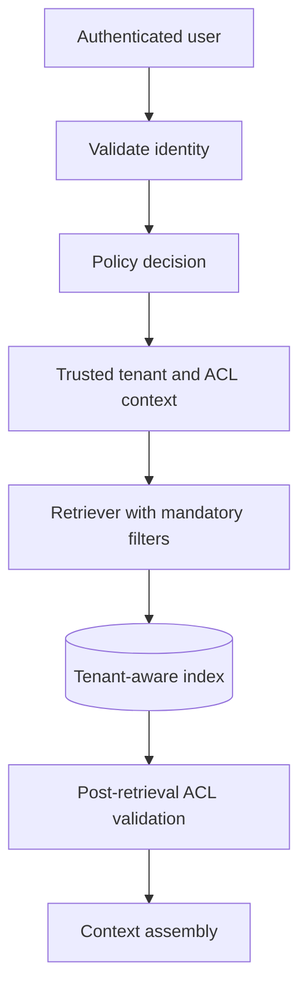

Required controls:

- Derive tenant identity from verified authentication claims.
- Apply mandatory tenant filters server-side.
- Enforce document-level ACLs.
- Recheck authorization after retrieval and before prompt assembly.
- Include tenant and permission scope in cache identity.
- Ensure parent-document resolution and citation links enforce the same policy.
- Test cross-tenant leakage explicitly.

## Retrieved prompt injection

Retrieved documents are untrusted data. They may contain instructions such as “ignore prior rules” or attempts to exfiltrate secrets.

Defences:

- Delimit retrieved text as untrusted evidence.
- Tell the model document text is evidence, not instruction.
- Never execute instructions found in retrieved content.
- Keep tool permissions outside document content.
- Validate outputs and authorize tools independently.
- Do not put secrets in model context.

## Failure handling

| Failure | Example | Response |
|---|---|---|
| Transient network | Search timeout | Bounded retry with backoff |
| Rate limit | HTTP 429 | Respect retry-after and limit concurrency |
| Authentication | Expired service credential | Refresh through supported identity flow; fail closed |
| Authorization | No document access | Return no unauthorized evidence |
| Invalid query | Unsupported filter | Validate and reject or safe fallback |
| Empty retrieval | No relevant evidence | Clarify, broaden safely, or abstain |
| Reranker outage | Ranking API unavailable | Documented fallback ranking |
| LLM timeout | Generation failure | Bounded retry within total deadline |
| Corrupt source | Extraction error | Quarantine and report ingestion failure |

Retry only transient, idempotent operations. Use exponential backoff with jitter, per-attempt and total deadlines, bounded retries, circuit breakers, and concurrency limits. Do not retry permanent validation or authorization errors.

# 19. Evaluation, observability, and optimization

A production retriever needs offline evaluation and online telemetry. “The answer looks good” is not a reliable metric.

| Metric | Meaning |
|---|---|
| Recall@k | Fraction of relevant docs found in top k |
| Precision@k | Fraction of top-k docs that are relevant |
| MRR | Rank of first relevant result |
| NDCG@k | Ranking quality with graded relevance |
| Hit rate | Whether at least one relevant item appears |
| Context precision | How much supplied context is relevant |
| Context recall | Whether required evidence was retrieved |

For generated answers also measure faithfulness, answer relevance, citation correctness, citation coverage, completeness, and abstention quality.

Evaluation record example:

```json
{
  "query": "How long is the annual leave carry-over period?",
  "tenant_id": "tenant-123",
  "relevant_chunk_ids": ["policy-456:v7:chunk-12"],
  "expected_facts": ["The policy-defined carry-over period"],
  "difficulty": "medium",
  "query_type": "policy_lookup"
}
```

Use corpus-grounded, expert-reviewed labels.

## Experiment matrix

| Experiment | Compare |
|---|---|
| Dense vs sparse | Vector only vs BM25 only |
| Hybrid | Vector + BM25 with RRF |
| Fusion weights | Different lexical/dense weights |
| Candidate size | Different top-k and fetch-k |
| MMR | Similarity vs MMR |
| Reranking | No reranker vs cross-encoder / managed ranker |
| Compression | None vs filter vs extraction |
| Query transformation | Original vs multi-query vs decomposition |
| Chunking | Sizes, overlap, structure-aware splitting |

Change one major variable at a time where practical.

## Observability

Capture structured metadata without logging sensitive document content by default:

```python
retrieval_trace = {
    "trace_id": "trace-abc",
    "tenant_id_hash": "hashed-tenant-id",
    "query_type": "technical_support",
    "retriever_names": ["vector", "bm25"],
    "vector_candidates": 30,
    "bm25_candidates": 30,
    "fused_candidates": 42,
    "reranked_candidates": 8,
    "compression_input_tokens": 12000,
    "compression_output_tokens": 2800,
    "retrieval_latency_ms": 180,
    "rerank_latency_ms": 240,
    "compression_latency_ms": 510,
    "cache_hit": False,
}
```

Use LangSmith or OpenTelemetry-compatible tracing to capture graph runs, node timings, model calls, tool calls, errors, and evaluation outcomes. Phoenix is another option for tracing and evaluation workflows.

## Caching

Possible cache layers: query embeddings, retrieval results, reranking, and (where safe) generated answers.

A retrieval cache key should include all result-affecting factors:

```text
hash(
  normalized_query,
  tenant_id,
  authorization_scope,
  filter_set,
  corpus_version,
  embedding_model_version,
  retriever_configuration
)
```

Never use a global cache key that can return one tenant's results to another. Define TTL and invalidation when documents, ACLs, or index versions change.

Avoid adding an LLM call to every request by default. Use deterministic normalization and direct retrieval for simple questions; invoke rewriting, decomposition, or compression only when evaluation shows the quality gain justifies the added latency and cost.

# 20. Production deployment blueprint

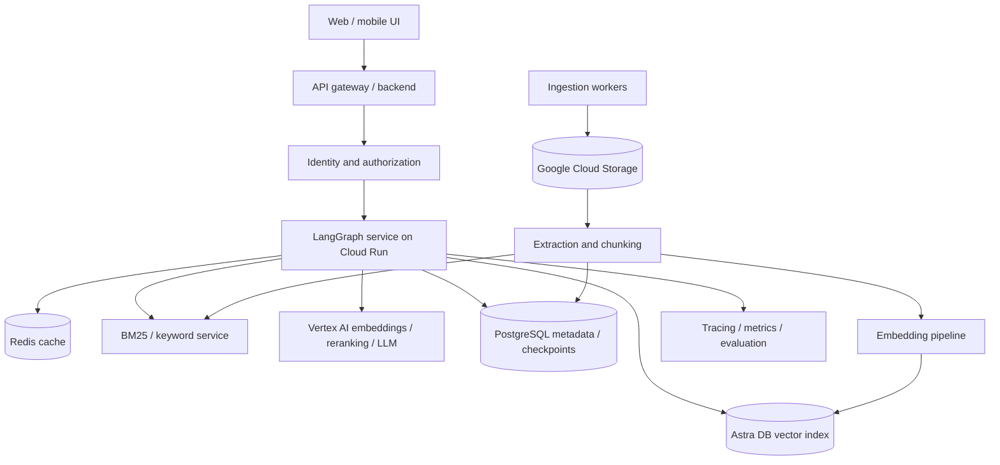

Suggested service boundaries:

| Service | Responsibility |
|---|---|
| Ingestion | Load, extract, clean, chunk, enrich, and version documents |
| Indexing workers | Generate embeddings and update vector/keyword indexes |
| Metadata/ACL service | Store document metadata and authorization policy |
| Retrieval nodes/service | Hybrid search, fusion, reranking, compression |
| LangGraph runtime | Orchestrate state, tools, retries, and generation |
| Cache | Tenant-scoped reusable results |
| Observability | Traces, metrics, logs, and quality evaluation |
| Admin interface | Manage corpora, versions, ACLs, and reindex jobs |

Example configuration:

```yaml
retrieval:
  vector:
    provider: astradb
    top_k: 30
    embedding_model: text-embedding-004

  keyword:
    provider: bm25
    top_k: 30

  fusion:
    algorithm: rrf
    k0: 60
    weights:
      vector: 0.6
      keyword: 0.4

  reranker:
    provider: vertex_ai
    top_n: 8

  compression:
    enabled: true
    max_documents: 10
    max_context_tokens: 8000

  query_planning:
    multi_query_enabled: false
    decomposition_enabled: true
    max_subqueries: 4

  safety:
    mandatory_tenant_filter: true
    post_retrieval_acl_check: true
    max_retrieval_attempts: 2
```

This is an illustrative schema; validate it at startup and map it to typed application settings.

## Production readiness checklist

### Ingestion and indexing
- [ ] PDF, table, code, and scanned-document extraction is tested.
- [ ] Chunking preserves headings and source structure.
- [ ] Stable document and chunk IDs are assigned.
- [ ] Metadata and ACL schemas are validated.
- [ ] Updates, deletes, and reindexing are idempotent.
- [ ] Embedding model and corpus versions are tracked.

### Retrieval
- [ ] Dense retrieval is evaluated independently.
- [ ] BM25 tokenization preserves important identifiers.
- [ ] RRF uses stable IDs and tested logic.
- [ ] Candidate counts and thresholds are configurable.
- [ ] Reranker fallback behaviour is defined.
- [ ] Compression preserves evidence and provenance.
- [ ] Empty and low-confidence retrieval paths are handled.

### Security
- [ ] Tenant identity comes from verified authentication.
- [ ] Mandatory filters cannot be removed by an LLM.
- [ ] ACL checks run before prompt assembly.
- [ ] Cache keys include tenant and authorization scope.
- [ ] Retrieved text is treated as untrusted.
- [ ] Citation links enforce authorization.
- [ ] Cross-tenant leakage tests run in CI.

### Reliability and operations
- [ ] Timeouts and bounded retries are configured.
- [ ] Circuit breakers and concurrency limits protect dependencies.
- [ ] Deadlines propagate across graph nodes.
- [ ] Partial failures have explicit handling.
- [ ] Traces include node-level timing and correlation IDs.
- [ ] Sensitive content and credentials are excluded from logs.
- [ ] Index refresh and rollback procedures are documented.

### Quality and cost
- [ ] A representative labelled query set exists.
- [ ] Recall@k, MRR, NDCG, and faithfulness are measured.
- [ ] Query transformations are tested against a baseline.
- [ ] Token usage and per-stage latency are measured.
- [ ] Cache effectiveness and invalidation are monitored.
- [ ] Quality regressions block unsafe releases.

---

# Appendix A — Retriever selection guide

| Requirement | Recommended starting point |
|---|---|
| Natural-language semantic search | Vector similarity |
| Exact IDs, error codes, names | BM25 |
| Semantic + exact matching | Hybrid vector + BM25 + RRF |
| Repetitive near-duplicate results | MMR |
| High-precision ordering | Cross-encoder reranking |
| Long documents with scattered evidence | Contextual compression |
| Different query phrasings | Multi-query |
| Compound questions | Query decomposition |
| Natural-language metadata constraints | Self-query, with server-enforced ACLs |
| Small chunks need larger context | Parent-document retrieval |
| Multiple document representations | Multi-vector retrieval |
| Different corpora/backends | Router, merger, custom retriever |
| Stateful retries and verification | LangGraph |

# Appendix B — Recommended baseline pipeline

```text
Authenticated request
    ↓
Trusted tenant and ACL context
    ↓
Lightweight query normalization
    ↓
Parallel dense + BM25 retrieval
    ↓
RRF fusion and stable-ID deduplication
    ↓
Cross-encoder / managed reranking
    ↓
Optional contextual compression
    ↓
Post-retrieval authorization validation
    ↓
Token-budgeted context assembly
    ↓
Grounded answer with citations
    ↓
Trace, evaluate, and record feedback
```

Add multi-query or decomposition only for query classes where offline evaluation demonstrates measurable improvement.

# Appendix C — Key design principles

1. Retrieval quality is an end-to-end property: ingestion, chunking, metadata, ranking, and context assembly all matter.
2. Hybrid retrieval is a strong baseline because dense and lexical search solve different problems.
3. Use RRF when score scales are incompatible; fuse ranks rather than blindly adding raw scores.
4. Rerank a bounded candidate set.
5. Compress after relevance selection and preserve source provenance.
6. Treat query transformation as conditional; more model calls do not automatically improve retrieval.
7. Authorization is deterministic infrastructure, never an LLM responsibility.
8. Evaluate with labelled data and domain-reviewed evidence.
9. Make each stage observable so failures can be localized.
10. Tune quality, latency, and cost together rather than optimizing a single metric.
