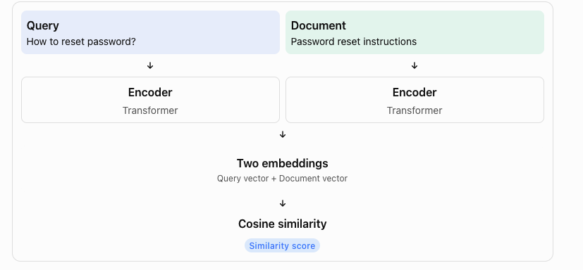
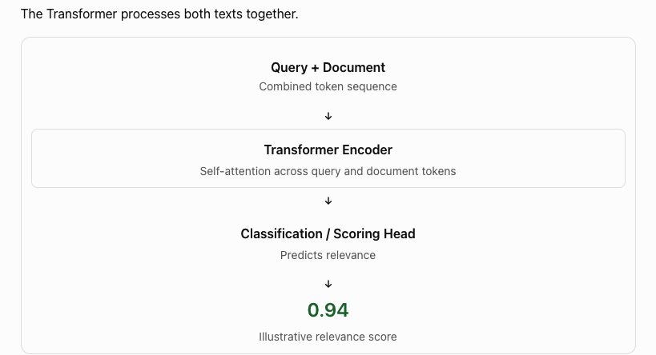

# Rerankers in RAG Systems

## 1. Overview

Rerankers help improve retrieval accuracy by ensuring that the documents passed to the LLM are the most relevant to the user's actual question.

- **Vector similarity** measures semantic similarity, not necessarily precise relevance to the question.
- **A reranker** takes the initially retrieved documents and re-evaluates their relevance against the original query.

### Retrieval Pipeline Roles
- **Retriever:** Finds potentially relevant documents.
- **Reranker:** Determines which retrieved documents are most relevant.
- **LLM:** Uses the selected documents to generate an answer.

---

## 2. Key Functions

A reranker performs three primary functions:

1. **Re-scoring**: Assigns a relevance score to each retrieved document.
2. **Filtering**: Selects the top N most relevant documents.
3. **Ordering**: Sorts documents by their relevance score.

---

## 3. How Does a Reranker Work Internally?

The most important concept to understand is the difference between a **bi-encoder** and a **cross-encoder**.

### 3.1 Bi-encoder Architecture

In a bi-encoder:
- The query and document are encoded independently.
- Their token-level interactions do not happen inside the same Transformer forward pass.
- This makes bi-encoders extremely efficient for searching millions of documents.

### 3.2 Cross-encoder Architecture

A cross-encoder works differently: it reads the query and document together as a single input in a single forward pass.

**Architecture Flow:**
- **Input:** `[CLS] <query> [SEP] <document> [SEP]`
- **Encoder:** Transformer
- **Embeddings:** Shared embeddings
- **Output:** Single output &rarr; Relevance score

This allows the model to understand the interaction between query terms and document terms, which is crucial for accurate relevance scoring.

### 3.3 Comparison: Bi-encoders vs. Cross-encoders

#### Feature Comparison

| Feature | Bi-encoder | Cross-encoder |
| :--- | :--- | :--- |
| **Input** | Query and document encoded independently | Query and document encoded together |
| **Attention** | No cross-attention between query and document | Full cross-attention between query and document |
| **Speed** | Very fast (can pre-compute document embeddings) | Slower (requires re-encoding for each query-document pair) |
| **Accuracy** | Good | Excellent |
| **Use Case** | Initial retrieval from large corpora | Re-ranking of small sets of retrieved documents |

#### Characteristics Summary

| Characteristic | Bi-encoder | Cross-encoder |
| :--- | :--- | :--- |
| **Input** | Separate texts | Query + document |
| **Encoding** | Independent | Joint |
| **Output** | Embeddings | Relevance score |
| **Search Speed** | Very fast | Slower |
| **Accuracy** | Good retrieval | Better precise ranking |
| **Precomputation** | Document embeddings | Usually no |
| **Suitable For** | Millions of documents | Top 20–100 candidates |

**A useful rule:**
- **Bi-encoder** = Find relevant documents.
- **Cross-encoder** = Understand which documents are actually relevant.

---

## 4. Types of Rerankers

There are several approaches; they are not all based on the same architecture.

### 4.1 Cross-encoder Rerankers *(Most Important to Learn)*

These are Transformer-based models trained to predict relevance between a query and a document.

**Examples:**
- `cross-encoder/ms-marco-MiniLM-L-6-v2`
- `BAAI/bge-reranker-base`
- `BAAI/bge-reranker-large`
- `BAAI/bge-reranker-v2-m3`

**Advantages:**
- Strong relevance estimation.
- Good for question-answering retrieval.
- Can distinguish similar but irrelevant documents.
- Can run locally.

**Disadvantages:**
- More computationally expensive than embedding retrieval.
- Every candidate requires inference.
- GPU or CPU capacity affects latency.

### 4.2 LLM-based Rerankers

Instead of using a dedicated cross-encoder, an LLM evaluates the relevance of documents. The LLM evaluates the documents and returns their scores.

**Advantages:**
- Can handle complex relevance criteria.
- Can understand business-specific instructions.
- Can evaluate structured information.

**Disadvantages:**
- Higher latency.
- Higher inference cost.
- Output consistency and scoring calibration need attention.

> **Note:** I would not use an LLM for ordinary reranking in a latency-sensitive RAG pipeline unless the complexity justifies it.

### 4.3 API-based Rerankers

These are hosted reranking services where the service returns ranked documents and relevance scores.

**Examples:**
- Cohere Rerank and hosted reranking models from other providers.

**Advantages:**
- No model hosting.
- Easy integration.
- Managed inference infrastructure.
- Good option for production systems.

**Disadvantages:**
- Network latency.
- API cost.
- External data transmission and privacy considerations.

---

## 5. Popular Reranker Models

These are models worth knowing as an AI/RAG engineer.

### Hugging Face Models

#### 1. BAAI BGE Reranker
- `BAAI/bge-reranker-base`
- `BAAI/bge-reranker-large`
- `BAAI/bge-reranker-v2-m3`

*Good general-purpose cross-encoder family.*
- **Model Type:** Hugging Face model

#### 2. MS MARCO MiniLM
- `cross-encoder/ms-marco-MiniLM-L-6-v2`
- `cross-encoder/ms-marco-MiniLM-L-12-v2`

*Good for learning and lightweight local deployment.*
- **Model Type:** Hugging Face model

#### 3. Qwen3 Reranker
- `Qwen/Qwen3-Reranker-0.6B`
- `Qwen/Qwen3-Reranker-4B`
- `Qwen/Qwen3-Reranker-8B`

*A newer instruction-aware reranker family for more complex relevance evaluation.*
- **Model Type:** Hugging Face model

### Hosted Reranking Services

#### 4. Cohere Rerank (API)
Not a Hugging Face model, but essential to know for production. The API endpoint performs reranking for you.

| Provider | Model | Characteristics |
| :--- | :--- | :--- |
| **Cohere** | `rerank-v5.0-pro` | High-quality multilingual |
| **Cohere** | `rerank-v5.0-fast` | Lower latency |
| **Cohere** | `rerank-v4.0-pro` | Advanced relevance |
| **Cohere** | `rerank-v3.5` | Earlier generation |

---

## 11. Production Considerations

### 11.2 Latency Optimization

Cross-encoder inference can become your retrieval bottleneck.

**Considerations:**
1. **Batch inference** instead of processing documents individually.
2. **Use GPU inference** where justified.
3. **Use smaller reranker models** for latency-sensitive workloads.
4. **Limit the number of candidates.**
5. **Deduplicate** before reranking.
6. **Truncate or intelligently chunk** excessively long documents.
7. **Use asynchronous API calls** where appropriate.
8. **Cache repeated query-document ranking results** when beneficial.

### 11.4 Security and Multi-tenancy

For an enterprise RAG system:
- Apply tenant filters during initial retrieval.
- Enforce document-level RBAC before reranking.
- Never allow reranking to introduce documents outside the authorized candidate set.
- Avoid sending sensitive documents to external reranking APIs without appropriate data-processing approval.
- Log model version, candidate IDs, ranking latency, and scores.
- Avoid logging sensitive document content unnecessarily.

> **Important:** Reranking is not an authorization mechanism. Access control must be enforced independently.

### 11.5 Failure Handling

Consider these failure scenarios and recommended handling:

| Failure | Recommended Handling |
| :--- | :--- |
| **Reranker API timeout** | Bounded retry or controlled fallback |
| **Model unavailable** | Use initial retrieval ranking if safe |
| **Empty candidate list** | Return no-context outcome |
| **All scores below threshold** | Retry retrieval or abstain |
| **Invalid model response** | Validate and reject |
| **Excessive latency** | Enforce deadline and fallback |

---

## 12. How Do We Evaluate Reranker Performance?

This is essential for an AI engineer. You should evaluate reranking independently from your vector retrieval.

### Key Evaluation Metrics

| Metric | What It Measures |
| :--- | :--- |
| **MRR** | How early the first relevant document appears |
| **NDCG@K** | Quality of the ranking, including graded relevance |
| **Precision@K** | How many selected documents are relevant |
| **Recall@K** | How many relevant documents are retrieved |
| **MAP** | Average precision across queries |

### Important Distinction

> **A reranker cannot recover a relevant document that the initial retriever never retrieved.**

Therefore, measure both:
1. **Candidate retrieval quality** before reranking.
2. **Ranking quality** after reranking.
